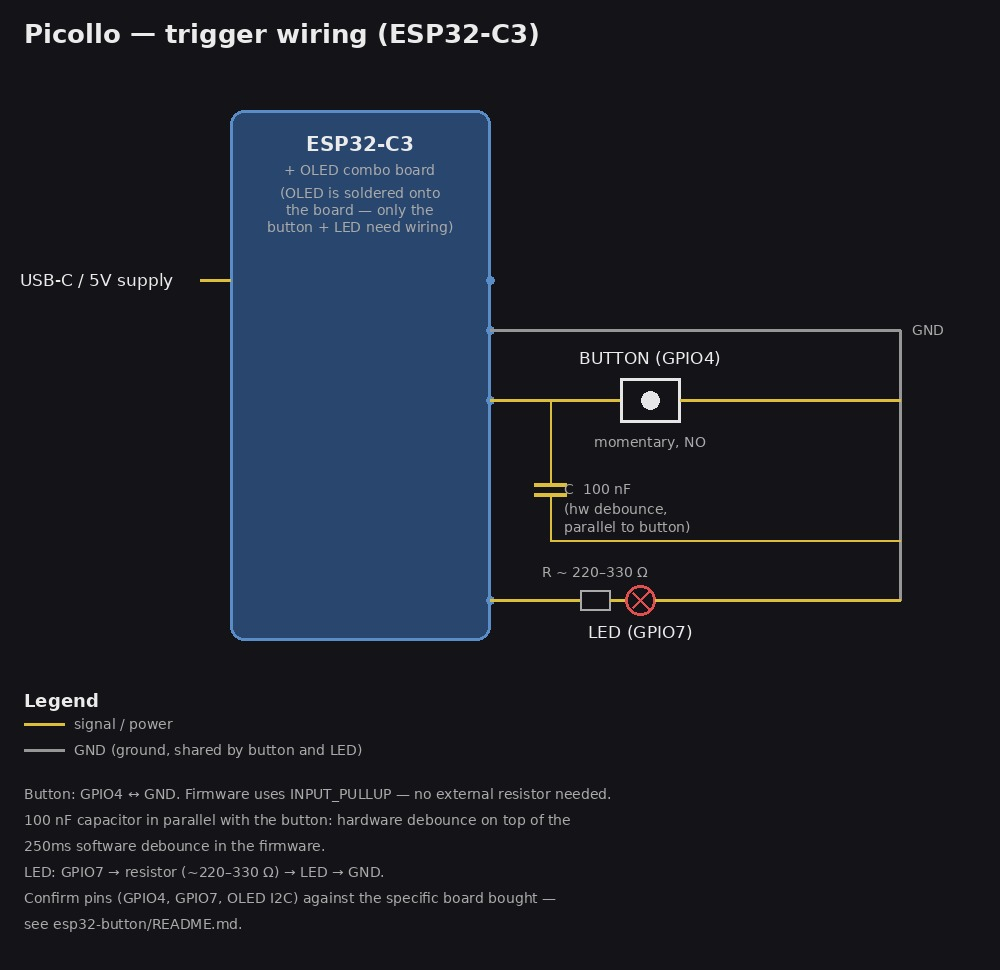

# ESP32-C3 button firmware

Target board: **ESP32-C3 with onboard OLED** (provisional choice — "zatím").
See `../PROJECT.md` for the overall design.

## How the trigger works (two-stage)

1. **First press** → arms liveview: POSTs `/liveview/start` to the NUC, so
   the kiosk display switches from its idle screen to a live camera feed
   (guest sees themselves). OLED shows `Divej se!`, status LED turns on solid.
2. **Second press** → POSTs `/capture`, which takes the actual photo (the
   NUC also stops liveview automatically as part of handling this). OLED
   shows `Fotim...` then the result (`Vyfoceno!` / `Obsazeno, zkus znovu` /
   `Chyba: <code>`), LED blinks fast during the shot then turns off.
3. If nobody follows through with a second press within ~20s, the armed
   state times out automatically (`/liveview/stop`), kiosk reverts to idle,
   LED turns off.

## Before flashing

Edit the top of `button/button.ino`:

- `WIFI_SSID` / `WIFI_PASSWORD` — the booth's private AP credentials.
- `NUC_HOST` — the NUC's IP address on that AP (static/reserved, not DHCP-drifting).
- `BUTTON_PIN` (default GPIO4) and `LED_PIN` (default GPIO7) — fine for most
  C3 boards, but confirm they're free on the specific module (OLED wiring
  sometimes claims nearby pins).
- `OLED_SDA` / `OLED_SCL` and `SCREEN_WIDTH` / `SCREEN_HEIGHT` — **must
  confirm against the exact board bought**. These are guesses (GPIO5/6,
  128x64). Many tiny "ESP32-C3 + 0.42in OLED" combo boards are actually
  72x40 pixels with display pins hardwired on the PCB, not the display's
  I2C address/size varying by vendor — check the product page/schematic.

## Wiring

- Button: one leg to `BUTTON_PIN`, other leg to GND. Firmware uses
  `INPUT_PULLUP`, so no external resistor needed.
- Debounce capacitor: ~100 nF ceramic, wired in parallel across the
  button's two legs. The firmware already does a 250ms software debounce,
  so this is extra insurance against contact bounce/electrical noise on a
  button that'll get mashed by strangers all day — not strictly required,
  but cheap and worth it.
- LED: `LED_PIN` → series resistor (~220–330 Ω) → LED → GND.
- OLED: I2C (SDA/SCL as configured above) — likely already wired on-board
  if it's an integrated combo module.
- Power: USB or a 5V line to the ESP32 at the button stand (see
  `PROJECT.md`).
- ESP32-C3 strapping pins are **2, 8, 9** — avoid reusing these for the
  button, LED, or anything that must read stable at boot.

### Trigger wiring diagram



The button and LED are the only things that need wiring by hand on most
combo boards — the OLED is normally already soldered to the same PCB.
(Diagram source: `generate_wiring_diagram.py`, not part of the firmware —
rerun it if the pinout above changes.)

## Flashing

### From the NUC (`flash.py`) — if the board is plugged into the NUC itself

```sh
python3 flash.py            # auto-detects /dev/ttyACM*/ttyUSB*, compiles, uploads
python3 flash.py --watch    # same, then streams serial output for 10s after
```

Needs `arduino-cli` (`~/.local/bin/arduino-cli`), the `esp32:esp32` core,
and the two libraries below — one-time setup:

```sh
arduino-cli core install esp32:esp32
arduino-cli lib install "Adafruit SSD1306" "Adafruit GFX Library"
```

Serial-port access needs the `dialout` group (`sudo usermod -aG dialout
$USER`, then log out and back in — or prefix commands with `sg dialout -c
'...'` to pick it up immediately without a relogin).

`flash.py` always builds with `CDCOnBoot=cdc` — **required** on the C3 for
`Serial.print()` to actually reach the USB port; without it the firmware's
own debug output silently goes nowhere (confirmed on real hardware: only
ESP-IDF's internal Wi-Fi log lines showed up until this was set).

### From the Arduino IDE (a separate machine with a GUI)

1. Boards Manager → install **esp32** (Espressif Systems). Library Manager
   → install **Adafruit SSD1306** and **Adafruit GFX Library**.
2. Board: "ESP32C3 Dev Module" (or the board's specific variant if listed).
   **Tools → USB CDC On Boot → Enabled** (see note above).
3. Open `button/button.ino`, fill in the config, select the port, upload.

Either way, watch the display/LED through the sequence in "How the trigger
works" above; `flash.py --watch` (or `arduino-cli monitor -p <port> -c
baudrate=115200`) also shows boot/Wi-Fi/capture logging over serial.

## Status

**Flashed and boot-verified on real hardware (2026-11-06):** compiles,
uploads, and boots via `flash.py` from the NUC. Confirmed on serial:
`OLED init OK` — the guessed I2C pins/address (GPIO5/6, 0x3C) are correct
for this board. Still open: `WIFI_SSID`/`WIFI_PASSWORD`/`NUC_HOST` are
placeholders (board currently loops retrying Wi-Fi), `SCREEN_WIDTH`/
`SCREEN_HEIGHT` (128x64) aren't visually confirmed yet, and the button/LED/
capacitor wiring hasn't been tested — OLED-only so far.
