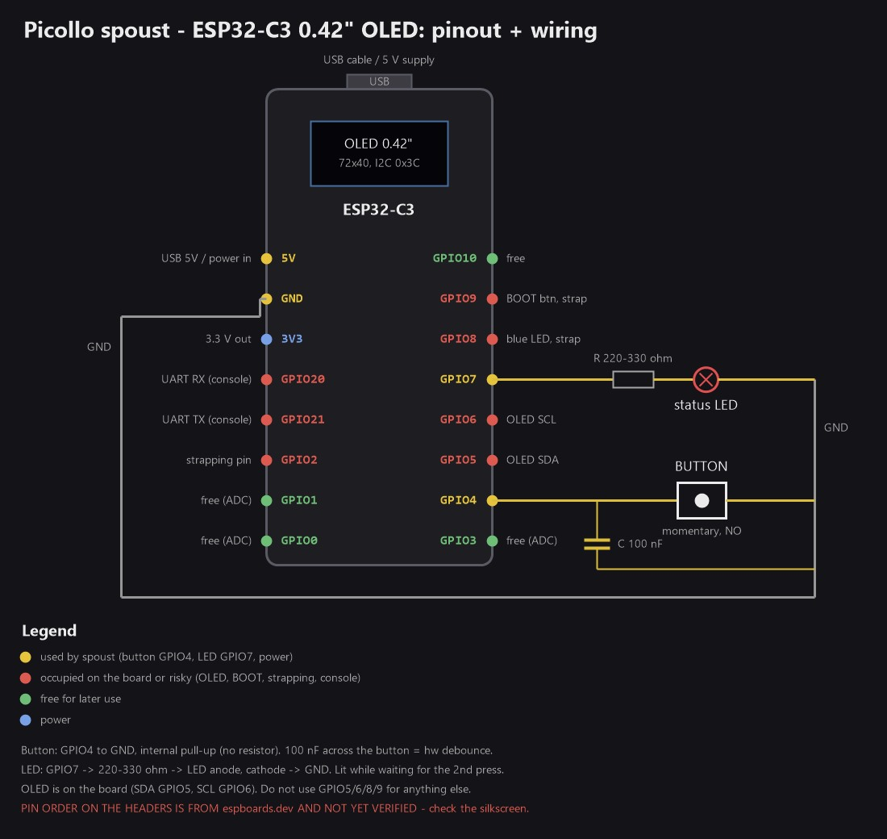

# spoust: ESP32-C3 trigger button firmware (ESP-IDF)

Firmware for the booth's physical trigger button. Replaces the Arduino
sketch formerly in `esp32-button/` (now removed). Built with PlatformIO +
ESP-IDF 5.5, with no external libraries: the OLED is driven directly through the IDF
`i2c_master` driver with a built-in 5x7 font. See `../PROJECT.md` for the
overall design.

## Board

**ESP32-C3 with an onboard 0.42" OLED** (common "ESP32-C3 OLED" mini board,
ESP32-C3FH4, 4 MB flash).

| Onboard part | Pin | Notes |
|---|---|---|
| OLED SSD1306 72x40, I2C `0x3C` | SDA **GPIO5**, SCL **GPIO6** | Confirmed on our board. The visible 72x40 window starts at **column 28** of the controller's RAM (`OLED_XOFS` in `main.c`). Without that offset the text renders garbled. |
| Blue LED | GPIO8 | Active LOW. GPIO8 is also a strapping pin. spoust uses it as the NUC-reachable indicator (see Behaviour). |
| BOOT button | GPIO9 | Strapping pin. Hold it while plugging in USB to force download mode. |
| RST button | EN | Resets the chip. |

ESP32-C3 strapping pins are **GPIO2, GPIO8 and GPIO9**. Don't use them for
anything that has to read a stable level at boot. GPIO20/21 are the UART0
console. Some listings put the OLED on GPIO8/9. That's wrong for this board,
which uses GPIO5/6.

## Pinout and wiring



> **The pin order on the headers comes from
> [espboards.dev](https://www.espboards.dev/esp32/esp32-c3-oled-042/) and
> hasn't been checked against our board yet.** The GPIO functions are right.
> Only where each pin sits on the header is unconfirmed. Check the
> silkscreen before soldering, then fix the order in `docs/wiring.ps1` if
> needed and rerun it.

Header pins, in the source's order:

| # | Pin | Use in spoust | # | Pin | Use in spoust |
|---|---|---|---|---|---|
| 1 | 5V | power in (or USB) | 9 | GPIO10 | free |
| 2 | **GND** | **button + LED ground** | 10 | GPIO9 | BOOT button, strapping, avoid |
| 3 | 3V3 | 3.3 V out | 11 | GPIO8 | onboard LED, strapping, avoid |
| 4 | GPIO20 | UART RX console, avoid | 12 | **GPIO7** | **status LED** |
| 5 | GPIO21 | UART TX console, avoid | 13 | GPIO6 | OLED SCL, taken |
| 6 | GPIO2 | strapping, avoid | 14 | GPIO5 | OLED SDA, taken |
| 7 | GPIO1 | free (ADC) | 15 | **GPIO4** | **trigger button** |
| 8 | GPIO0 | free (ADC) | 16 | GPIO3 | free (ADC) |

What you wire by hand (the OLED is already on the board):

- **Button** (momentary, normally open): one leg to **GPIO4**, the other to
  **GND**. The firmware enables the internal pull-up, so no resistor is
  needed. A press reads LOW.
- **100 nF ceramic capacitor** in parallel across the button's two legs, for
  hardware debounce. The firmware also debounces (the level must hold 30 ms,
  and presses closer than 250 ms are ignored), so this is extra insurance
  for a button that strangers press all day.
- **Status LED**: **GPIO7** → 220–330 Ω resistor → LED anode, LED cathode →
  **GND**.
- **Power**: USB, or 5 V on the `5V` pin at the button stand.

Pins are defined at the top of `src/main.c` (`PIN_BUTTON`, `PIN_LED`,
`PIN_SDA`, `PIN_SCL`).

## Behaviour

Two presses, the same flow the listener expects:

| State | OLED | Status LED |
|---|---|---|
| Connecting to Wi-Fi | `WiFi` + dots | slow blink |
| Ready | `WiFi OK` + IP | off |
| 1st press → `POST /liveview/start` | `Liveview ...` | fast blink |
| Waiting for 2nd press (max 20 s) | `Zmackni znovu` / `Divej se!` | on |
| 2nd press → `POST /capture` | `Fotim...` | fast blink |
| Result (1.5 s) | `Vyfoceno!` / `Obsazeno` (409) / `Chyba <code>` / `Bez NUC` | off |

- With no second press within 20 s, it sends `POST /liveview/stop` and goes
  back to Ready.
- After every press the OLED shows a third line, `pressed`, for 3 s, even
  without Wi-Fi. While it's shown, the state's main message moves to line two
  in small text.
- **Onboard blue LED = NUC reachable.** Every 5 s the board sends
  `GET /health` to the listener. Until 3 checks in a row succeed, the LED
  flashes for 500 ms on each check. After that it stays on. The first failed
  check, or a Wi-Fi drop, goes back to flashing.
- Presses made while a request is still in flight are discarded, and so are
  presses while Wi-Fi is down.
- If Wi-Fi stays down for 2 minutes, the board restarts itself.
- The display and LED run in their own task, so they keep updating during
  the up to 40 s `/capture` request.

## Configuration

**Wi-Fi credentials** live in `include/wifi_secrets.h`. That file is
gitignored, so create it from the template:

```sh
cp include/wifi_secrets.h.example include/wifi_secrets.h
# edit WIFI_SSID / WIFI_PASSWORD
```

The SSID is case-sensitive and is lowercase `picollo`. A wrong case shows up
as disconnect reason 201 (`NO_AP_FOUND`).

**NUC address**: `NUC_HOST` / `NUC_PORT` in `src/main.c` (default
`10.0.2.10:8080`). You can also override them without editing code, in
`platformio.ini`:

```ini
build_flags = -DNUC_HOST=\"10.0.2.10\" -DNUC_PORT=8080
```

## Build and flash

With the PlatformIO extension in VS Code, or the CLI:

```sh
pio run                     # build
pio run -t upload           # flash over USB
pio device monitor -b 115200
```

If the upload doesn't start, hold **BOOT**, tap **RST**, release BOOT, and
retry. The serial log prints the Wi-Fi disconnect reason codes and every
`POST` with its HTTP status.

## Regenerating the diagram

`docs/wiring.jpg` is generated by `docs/wiring.ps1` (Windows PowerShell,
System.Drawing, nothing to install):

```powershell
powershell -ExecutionPolicy Bypass -File docs\wiring.ps1
```

## Status

- OLED (with the column-28 offset) and Wi-Fi are working on real hardware.
- Tested on the board (2026-11-14): button press, `pressed` line, `/health`
  check with the blue LED, and `POST /liveview/start` → 200. `POST /capture`
  reached the NUC but returned 409 (camera lock busy), which is the known
  gphoto2/camera issue on the NUC side.
- The external status LED (GPIO7) isn't wired yet.
- Builds with PlatformIO `espressif32` 8.0.0, which brings ESP-IDF 6.1. The
  app uses 97% of its 1 MB partition, so expect to make room (for example,
  turn off HTTPS in the HTTP client) before adding much more.
- The header pin order is unverified (see above).
